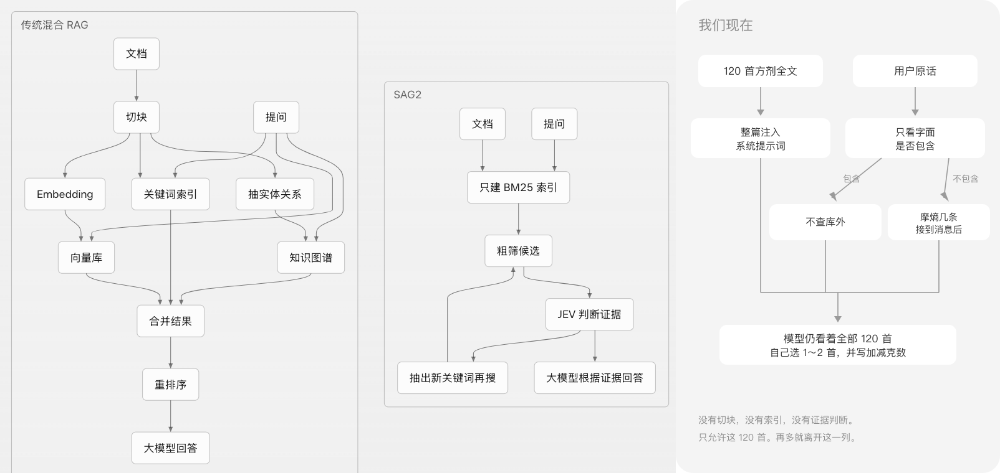
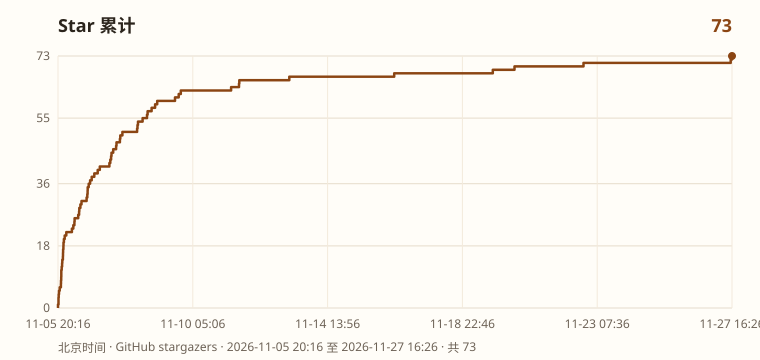

## 赞助商：[ChainFuel](https://chainfuel.tap365.org/)

**ChainFuel 提供稳定、低价的大模型接口。** 在现有工具里填一把密钥和 Base URL，按 OpenAI 兼容方式调用 GPT、Claude、Grok、Gemini、GLM、Kimi、DeepSeek。

**注册福利：余额 2 刀 + 5 刀订阅体验。现在邀请新用户购买，赠送一个月订阅套餐。**

# 袁淑芳墓碑验方库

网站：https://mason0510.github.io/yuan-shufang-formulas/

推到 `main` 后，由 `.github/workflows/ci.yml` 测试、打包并发布页面。

河南西平县芦庙乡盘龙桥村老中医**袁淑芳**（行医八十余年）遗愿：将毕生精要验方刻于墓碑，供后人借鉴。

## 初心

袁淑芳把验方刻上墓碑，是要留给后来的人，不是锁在家里。我们接着做这件事：把碑方和各方交来的古方开源。开源属于全人类。

## 号召

这个库收未公开的民间古方：墓碑、家传抄本、地方抄本、口述、照片。目标是做成这一类里最大的开源库。已经出版、在公开古籍库里有稳定出处的成方，只记线索，不拿来充首数。倪海厦等今人著作只收书名、方名和页码。请把持有人、地点、载体和原文交到 [open-medical](https://mason0510.github.io/yuan-shufang-formulas/open-medical.html)。交来的内容单独入库，不自动写进这 120 首墓碑验方。

本仓库据墓碑照片誊录 + 公开电子版互校，整理为可检索、可程序化调用的开源验方数据，并附带可直接启动的开方智能体说明。

> **重要**：仅供专业辨证学习参考，**不可自行照方抓药**。家属强调碑方只是参考框架，须按体质加减。穿山甲等管控/禁用野生药材须换合法代用品并注明非原方。

## 本库收录

| 项目 | 说明 |
|------|------|
| 收录 | 120 首（碑称百首；立面四末段风化未补） |
| 分类 | 妊娠、产后、不孕、经带、儿科、内科、外科、五官 |
| 格式 | JSON + Markdown |
| 标记 | `ctrl` 管控药 / `doubt` 存疑（照片与电子版冲突或残缺） |

## 目录

```
data/formulas.json                 # 机器可读
data/formulas.md                   # 人类可读
data/sources/xhs-100fang/          # 小红书 22 张实拍誊录底本
agent/                             # 开方智能体：系统提示 + 启动说明
docs/disclaimer.md                 # 合规与使用边界
```

## 快速使用数据

```bash
# 按病证检索
jq '.formulas[] | select(.ind | contains("痛经"))' data/formulas.json
```

## 启动开方智能体

见 [`agent/README.md`](agent/README.md)。把 `agent/SYSTEM.md` 贴进任意支持自定义系统提示的对话模型即可开箱使用；或在 Grok Bot / Cursor 中导入同名 Agent。

## 现在怎么选方，和 RAG 的差别



第一列是传统混合 RAG。文档先切块，再走向量、关键词和实体关系，合并后重排，最后才交给大模型。口语化、非标的主诉，以及超过 120 首以后的民间方，走这一列。日常增删改几篇只做增量：按文档删掉旧切块，再切分入库。必须全量重建的只有四件事：更换 Embedding 模型，改切分或预处理，改索引、距离度量或过滤字段，以及 GraphRAG 这类跨文档结构要重抽。

第二列是 SAG2。只建 BM25 索引，粗筛候选，JEV 判断证据；证据不够就抽出新关键词再搜，够了才由大模型根据证据回答。合同、代码、术语、规格表、制度和预案这类固定大资料才用这一列。问法和原文不同字时，词面起点会漏，所以不拿来选民间方。

第三列是我们现在。120 首全文整篇注入系统提示词。程序只看用户原话里有没有逐字包含病证或方名。包含就不查库外，不包含才把摩熵返回的几条接到用户消息后面。两条路最后都是模型看着全部 120 首，自己选 1～2 首。没有切块，没有索引，没有证据判断。

第四列是 Claude Code，也就是套餐 claudecode 打开仓库时的检索。它没有事先建好的向量库。Glob 只按路径和文件名找文件。Grep 用正则搜正文，命中可以在文件任何一行，不只是开头几段。然后 Read 打开命中的文件：默认可以从第 1 行读，也可以指定偏移往后读。看完这一段，再决定要不要继续搜。模型只根据读到的片段回答。这一列用于会改动的代码仓库，不拿来选方。

现在用全文，是因为这 120 首还装得下，而且漏检的代价比多看几首更大。

- 方剂表约 9100 字，平均每首约 76 字，一次请求能装完。最后一首不会被截掉。每一行已经是一条短记录，不需要再切块。
- 这 120 首是核对过的封闭集。检索一旦没命中，这首方就不会出现在提示词里，模型无法选它。「孕吐」对不上「妊娠呕吐」时，全文仍能看见妊娠呕吐那一行；RAG 会把它留在库里。
- 允许进入第三列的只有这 120 首。全文让每一次选择都面对同一份名单。检索子集少带一首，模型会当成库里没有。

第二列适合文档常改、要改完即搜、本地或没有 GPU、答案散在多份文件、以及型号、编号、条款必须按字命中的大资料。合同套话、代码里的死分支和旧版本、术语的多口径、规格差一个后缀、废止的制度和指南、步骤不能乱的预案，都要先隔离版本、剥掉套话，再检索。SAG2 不适合图片和视频的跨模态检索，也不适合一两秒内要答完的高并发客服。

整理精简和检索提速，出现在库已经大、又卡时间或卡对错的时候：检索只剩几十到两百毫秒，废止版和现行版同时在库里，端侧内存装不下，或者历史文档大到不能整段灌入。这 120 首还没到。摩熵约 10 万首是对方的库，不进系统提示词，也不由本库清洗或重建；对不上时只把返回的几条接到用户消息后面，并标明库外。

这不是说全文比 RAG 更适合大方库。方数一多，全文自己会把靠后的方截掉，漏掉的换成另一批。所以界限就卡在这 120 首。

现在高度依赖提示词注入。网页每次把 `docs/system.md` 整篇放进系统提示词。这篇约 1.0 万字，其中方剂表约 9100 字，120 首平均每首约 76 字。模型被要求自己选 1～2 首。程序不检索，只看原话里有没有逐字出现某条病证或方名。有，不查库外。没有，才把原话前 80 字交给摩熵，结果接在用户消息后面。两种情况下，模型都仍看着全部 120 首。

用不到的方也占着上下文。方数一多就先膨胀：费用、等待和注意力都随整库变长，还没到装不下，贴证的方已经被无关方冲淡。按每首约 76 字估算，1000 首仅方剂表约 7.6 万字，3000 首约 23 万字，1 万首约 76 万字。到几千首、几万首，整段注入会把靠后的方截掉，那些方永远选不中。

界限：划定一个小范围，范围内可以整段注入。超过这个范围，一定离开第三列。当前允许注入的范围就是这 120 首墓碑验方。再增加的民间方不进系统提示词。口语化、非标的走第一列。固定资料走第二列。正在改的代码仓库走第四列。

细节见 [`agent/README.md`](agent/README.md)。为何没选全量、而选了注入，见下一节。

## 为何没选择全量，而选择了注入

这 120 首选注入。方剂表约 9100 字，平均每首约 76 字，一次请求能装完。网页把 `docs/system.md` 整篇放进系统提示词。模型看着全部 120 首，自己选 1～2 首。程序不打分，不取子集。

全量和增量都是第一列里的更新方式。日常改几首可以增量：按文档删掉旧切块，再切分入库。全量重建只在四件事上发生：更换 Embedding 模型，改切分或预处理，改索引、距离度量或过滤字段，以及跨文档图谱要重抽。「RAG 必须全量」是错的。这 120 首没进第一列，所以全量和增量都没选。

没进第一列，是因为检索交出去的是子集。全量重建只让索引和原文对齐，不保证这次提问能命中那一首。用户说「孕吐」，病证写的是「妊娠呕吐」。全量索引里有这一首，检索仍可能不把它送进提示词。模型会当成库里没有。注入后，那一行仍在。

注入能成立，是因为下面三条同时在：

- 这是核对过的封闭集。库里没有同一首的新旧两版。第一列要防旧文和近义套话占满前几名。这里要防的是漏掉那一行。
- 主诉经常和病证不同字。第二列从 BM25 词面起步，同样对不上「孕吐」和「妊娠呕吐」。
- 一次只从这一张表里选 1～2 首，不跨文件多跳。查询时的多轮检索用不上。

注入的范围就是这 120 首墓碑验方。装不下，或再增加的民间方，离开注入，进第一列。进了第一列，才谈增量还是全量。

### 这里碰到的技术

注入这条链路现在只用这些：

- 系统提示词整篇注入。Chat Completions 放在 `messages` 的 system；Responses 放在 `instructions`。方剂表不切块，不向量化。
- `localFormulaHit`：去掉空白后，看原话是否包含某条病证或方名，至少 2 个字。没有分词器，没有同义词表，没有 Embedding。
- 没命中才 `POST /v1/formulas/external`。浏览器只打自己的 Worker，摩熵密钥在 Worker 里。查询先去掉控制字符，再裁到 40 字。少于 2 字直接拒绝。2～8 字、以汤、散、丸、饮、膏、丹结尾、且没有问句标点的，查 `recipe_name`；其余够 2 字的查 `function`。字数按裁切后的原文计，不去空白。列表只取第 1 页，详情只开 1 条。只对这一条详情做连续 2 字校验，对不上就不引用。
- 模型仍看着全部 120 首。库外那几条接在用户消息后面，标明库外。选 1～2 首由模型做，程序不打分、不重排。

全量那条没启用。启用才会碰上这些：

- 切块、Embedding 模型、向量库、关键词索引、实体关系、合并、重排。
- 增量：按文档号删掉旧切块，再切分、向量化、入库。变动靠文档号、内容哈希或时间戳认出来。
- 全量：换 Embedding、改切分、改距离度量或过滤字段、跨文档图谱重抽。新索引先建好，测完再切别名，旧索引后删。

这些技术解决的是库大、每次只能送子集、还要拦住新旧两版。这 120 首要的是那一行必须在提示词里，所以上面这套没接。

## 合规边界

- 不对外宣称「AI 医生」「在线处方」
- 输出为**参考方**，须由有资质医师把关后抓药
- 缺药时给出合法代用，不建议使用野生保护动物药

## 许可

数据整理与文档采用 [CC BY-NC-SA 4.0](LICENSE)。墓碑碑文内容属公开史料抄录；使用时请注明出处并遵守当地医药法规。

## 来源与致谢

- 墓碑所在：河南驻马店西平县芦庙乡盘龙桥村
- 媒体报道与家属访谈（大河报等）确认碑方为参考框架、须辨证加减
- 本库由照片 OCR/人工誊录与电子传抄互校而成，欢迎纠错 PR


## 交流

微信群。图上的二维码 7 天内有效，至 2026-12-02。过期后换 `docs/group-qr.jpg`。


## 在线智能体（GitHub Pages）

启用仓库 Pages（Source: Deploy from branch → `/docs`）。

在线地址形如：`https://mason0510.github.io/yuan-shufang-formulas/`

页面、Worker 和登录库怎么部署，见 [docs/DEPLOY.md](docs/DEPLOY.md)。

## Star History

[](https://github.com/mason0510/yuan-shufang-formulas/stargazers)



曲线由每天 00:17（北京时间）的 GitHub Action `star-history` 重画，有新 star 才提交。手动重画：`python3 scripts/update_star_history.py <stargazers.tsv>`。徽章数字是 GitHub 实时计数，和这张图不是同一条更新路径。
