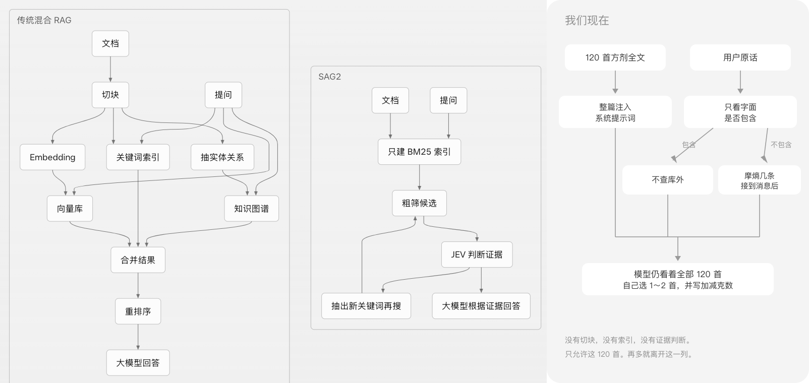

## 赞助商：[ChainFuel](https://chainfuel.tap365.org/)

**ChainFuel 提供稳定、低价的大模型接口。** 在现有工具里填一把密钥和 Base URL，按 OpenAI 兼容方式调用 GPT、Claude、Grok、Gemini、GLM、Kimi、DeepSeek。

**注册福利：余额 2 刀 + 5 刀订阅体验。现在邀请新用户购买，赠送一个月订阅套餐。**

# 袁淑芳墓碑验方库

网站：https://mason0510.github.io/yuan-shufang-formulas/

河南西平县芦庙乡盘龙桥村老中医**袁淑芳**（行医八十余年）遗愿：将毕生精要验方刻于墓碑，供后人借鉴。

## 初心

袁淑芳把验方刻上墓碑，是要留给后来的人，不是锁在家里。我们接着做这件事：把碑方和各方交来的古方开源。开源属于全人类。

## 号召

这个库收未公开的民间古方：墓碑、家传抄本、地方抄本、口述、照片。目标是做成这一类里最大的开源库。已经出版、在公开古籍库里有稳定出处的成方，只记线索，不拿来充首数。倪海厦等今人著作只收书名、方名和页码。请把持有人、地点、载体和原文交到 [open-medical](https://mason0510.github.io/yuan-shufang-formulas/open-medical.html)。交来的内容单独入库，不自动写进这 120 首墓碑验方。

本仓库据墓碑照片誊录 + 公开电子版互校，整理为可检索、可程序化调用的开源验方数据，并附带可直接启动的开方智能体说明。

> **重要**：仅供专业辨证学习参考，**不可自行照方抓药**。家属强调碑方只是参考框架，须按体质加减。穿山甲等管控/禁用野生药材须换合法代用品并注明非原方。

## 本库收录

| 项目 | 说明 |
|------|------|
| 收录 | 120 首（碑称百首；立面四末段风化未补） |
| 分类 | 妊娠、产后、不孕、经带、儿科、内科、外科、五官 |
| 格式 | JSON + Markdown |
| 标记 | `ctrl` 管控药 / `doubt` 存疑（照片与电子版冲突或残缺） |

## 目录

```
data/formulas.json                 # 机器可读
data/formulas.md                   # 人类可读
data/sources/xhs-100fang/          # 小红书 22 张实拍誊录底本
agent/                             # 开方智能体：系统提示 + 启动说明
docs/disclaimer.md                 # 合规与使用边界
```

## 快速使用数据

```bash
# 按病证检索
jq '.formulas[] | select(.ind | contains("痛经"))' data/formulas.json
```

## 启动开方智能体

见 [`agent/README.md`](agent/README.md)。把 `agent/SYSTEM.md` 贴进任意支持自定义系统提示的对话模型即可开箱使用；或在 Grok Bot / Cursor 中导入同名 Agent。

## 现在怎么选方，和 RAG 的差别



第一列是传统混合 RAG。文档先切块，再走向量、关键词和实体关系，合并后重排，最后才交给大模型。口语化、非标的主诉，以及超过 120 首以后的民间方，走这一列。

第二列是 SAG2。只建 BM25 索引，粗筛候选，JEV 判断证据；证据不够就抽出新关键词再搜，够了才由大模型根据证据回答。合同、代码、术语这类比较固定的资料才用这一列。SAG2 上生产有风险，不拿来选民间方。

第三列是我们现在。120 首全文整篇注入系统提示词。程序只看用户原话里有没有逐字包含病证或方名。包含就不查库外，不包含才把摩熵返回的几条接到用户消息后面。两条路最后都是模型看着全部 120 首，自己选 1～2 首。没有切块，没有索引，没有证据判断。

第四列是 Claude Code，也就是套餐 claudecode 打开仓库时的检索。它没有事先建好的向量库。Glob 只按路径和文件名找文件。Grep 用正则搜正文，命中可以在文件任何一行，不只是开头几段。然后 Read 打开命中的文件：默认可以从第 1 行读，也可以指定偏移往后读。看完这一段，再决定要不要继续搜。模型只根据读到的片段回答。这一列用于会改动的代码仓库，不拿来选方。

SAG2 和 Claude Code 是同一类，不是两种检索。两边都是先按字面去搜，看命中够不够，不够就换关键词再搜，最后只根据找到的原文回答。都不走向量库，也不把整库塞进提示词。

SAG2 多出来的两步算不上另一种方法，也不算对 Claude Code 的效果优化。

- BM25 索引只是把当场 Grep 换成一份事先建好的词频索引，并给出排序。资料不怎么改的时候，少扫一遍磁盘。仓库正在改，索引会旧，这一步还不如当场搜。
- JEV 只判断手头的证据够不够。它不改变搜到什么。Claude Code 里，同一个模型看完 Grep 结果自己决定要不要再搜。把这个判断换成单独一问，是多一道关口，不是把检索做准。

所以图上分两列，只为标出用在哪：固定的合同、代码、术语可以留下 BM25 索引；正在改的仓库用 Claude Code 当场搜。检索家族还是一个。

现在用全文，是因为这 120 首还装得下，而且漏检的代价比多看几首更大。

- 方剂表约 9100 字，平均每首约 76 字，一次请求能装完。最后一首不会被截掉。每一行已经是一条短记录，不需要再切块。
- 这 120 首是核对过的封闭集。检索一旦没命中，这首方就不会出现在提示词里，模型无法选它。「孕吐」对不上「妊娠呕吐」时，全文仍能看见妊娠呕吐那一行；RAG 会把它留在库里。
- 允许进入第三列的只有这 120 首。全文让每一次选择都面对同一份名单。检索子集少带一首，模型会当成库里没有。

这不是说全文比 RAG 更适合大方库。方数一多，全文自己会把靠后的方截掉，漏掉的换成另一批。所以界限就卡在这 120 首。

现在高度依赖提示词注入。网页每次把 `docs/system.md` 整篇放进系统提示词。这篇约 1.0 万字，其中方剂表约 9100 字，120 首平均每首约 76 字。模型被要求自己选 1～2 首。程序不检索，只看原话里有没有逐字出现某条病证或方名。有，不查库外。没有，才把原话前 80 字交给摩熵，结果接在用户消息后面。两种情况下，模型都仍看着全部 120 首。

用不到的方也占着上下文。方数一多就先膨胀：费用、等待和注意力都随整库变长，还没到装不下，贴证的方已经被无关方冲淡。按每首约 76 字估算，1000 首仅方剂表约 7.6 万字，3000 首约 23 万字，1 万首约 76 万字。到几千首、几万首，整段注入会把靠后的方截掉，那些方永远选不中。

界限：划定一个小范围，范围内可以整段注入。超过这个范围，一定离开第三列。当前允许注入的范围就是这 120 首墓碑验方。再增加的民间方不进系统提示词。口语化、非标的走第一列。字面检索只有一家：固定资料用第二列的 BM25 索引，正在改的仓库用第四列当场搜。

细节见 [`agent/README.md`](agent/README.md)。

## 合规边界

- 不对外宣称「AI 医生」「在线处方」
- 输出为**参考方**，须由有资质医师把关后抓药
- 缺药时给出合法代用，不建议使用野生保护动物药

## 许可

数据整理与文档采用 [CC BY-NC-SA 4.0](LICENSE)。墓碑碑文内容属公开史料抄录；使用时请注明出处并遵守当地医药法规。

## 来源与致谢

- 墓碑所在：河南驻马店西平县芦庙乡盘龙桥村
- 媒体报道与家属访谈（大河报等）确认碑方为参考框架、须辨证加减
- 本库由照片 OCR/人工誊录与电子传抄互校而成，欢迎纠错 PR


## 在线智能体（GitHub Pages）

启用仓库 Pages（Source: Deploy from branch → `/docs`）。

在线地址形如：`https://mason0510.github.io/yuan-shufang-formulas/`

页面、Worker 和登录库怎么部署，见 [docs/DEPLOY.md](docs/DEPLOY.md)。

## Star History

[](https://github.com/mason0510/yuan-shufang-formulas/stargazers)


曲线由 `python3 scripts/update_star_history.py <stargazers.tsv>` 重画。仓库里没有定时函数，不跑这句，图就停在上次写出的数字。
