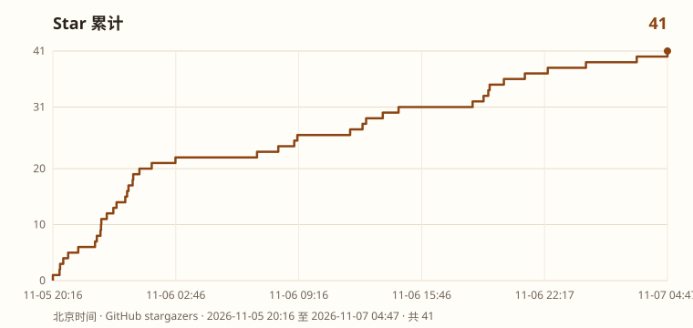

# 袁淑芳墓碑验方库

河南西平县芦庙乡盘龙桥村老中医**袁淑芳**（行医八十余年）遗愿：将毕生精要验方刻于墓碑，供后人借鉴。

本仓库据墓碑照片誊录 + 公开电子版互校，整理为可检索、可程序化调用的开源验方数据，并附带可直接启动的开方智能体说明。

> **重要**：仅供专业辨证学习参考，**不可自行照方抓药**。家属强调碑方只是参考框架，须按体质加减。穿山甲等管控/禁用野生药材须换合法代用品并注明非原方。

## 本库收录

| 项目 | 说明 |
|------|------|
| 收录 | 120 首（碑称百首；立面四末段风化未补） |
| 分类 | 妊娠、产后、不孕、经带、儿科、内科、外科、五官 |
| 格式 | JSON + Markdown |
| 标记 | `ctrl` 管控药 / `doubt` 存疑（照片与电子版冲突或残缺） |

## 目录

```
data/formulas.json                 # 机器可读
data/formulas.md                   # 人类可读
data/sources/xhs-100fang/          # 小红书 22 张实拍誊录底本
agent/                             # 开方智能体：系统提示 + 启动说明
docs/disclaimer.md                 # 合规与使用边界
```

## 快速使用数据

```bash
# 按病证检索
jq '.formulas[] | select(.ind | contains("痛经"))' data/formulas.json
```

## 启动开方智能体

见 [`agent/README.md`](agent/README.md)。把 `agent/SYSTEM.md` 贴进任意支持自定义系统提示的对话模型即可开箱使用；或在 Grok Bot / Cursor 中导入同名 Agent。

## 合规边界

- 不对外宣称「AI 医生」「在线处方」
- 输出为**参考方**，须由有资质医师把关后抓药
- 缺药时给出合法代用，不建议使用野生保护动物药

## 许可

数据整理与文档采用 [CC BY-NC-SA 4.0](LICENSE)。墓碑碑文内容属公开史料抄录；使用时请注明出处并遵守当地医药法规。

## 来源与致谢

- 墓碑所在：河南驻马店西平县芦庙乡盘龙桥村
- 媒体报道与家属访谈（大河报等）确认碑方为参考框架、须辨证加减
- 本库由照片 OCR/人工誊录与电子传抄互校而成，欢迎纠错 PR


## 在线智能体（GitHub Pages）

启用仓库 Pages（Source: Deploy from branch → `/docs`）。

在线地址形如：`https://mason0510.github.io/yuan-shufang-formulas/`

## Star History

[](https://github.com/mason0510/yuan-shufang-formulas/stargazers)



曲线由 `python3 scripts/update_star_history.py <stargazers.tsv>` 重画。仓库里没有定时函数，不跑这句，图就停在上次写出的数字。
